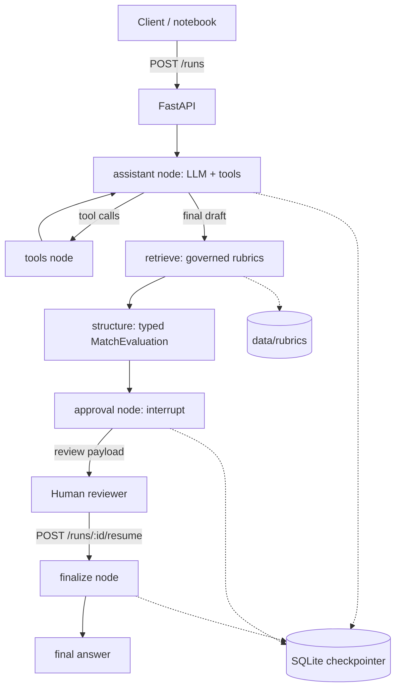

# JobMatch Agent

A CV ↔ job matching agent refactored from `Agent.ipynb` into an importable Python package with a FastAPI service, a SQLite checkpointer and a real human-in-the-loop (HITL) approval gate. This implements **all of Phase 1 and Phase 2 (2A + 2B)** of `improvements.md`.

## What is in place

- `src/jobmatch/` – importable modules instead of notebook cells.
- `src/jobmatch/api/main.py` – FastAPI endpoints `POST /runs`, `GET /runs/{thread_id}`, `POST /runs/{thread_id}/resume`, `GET /health`.
- `SqliteSaver` – durable state keyed by `thread_id` (default DB: `data/checkpoints.sqlite`).
- LangGraph `interrupt()` – the graph pauses after CV/job extraction and a draft assessment; `Command(resume=...)` continues deterministically.
- Model fallback chain and lazy Gemini client (no API key needed just to import the package).
- Typed `MatchEvaluation` (structured output) plus a deterministic fallback, exposed in the approval payload and API.
- SQLite TTL idempotency cache for URL fetches and CV extraction (`src/jobmatch/cache.py`).
- Per-run token, estimated-cost and latency telemetry (`src/jobmatch/telemetry.py`).
- Governed rubric retrieval with verified-only / date / metadata filters and `rubric-id@vN` citations (`src/jobmatch/retrieval/rubrics.py`).
- Golden-set eval harness for task success, faithfulness, latency and cost (`src/jobmatch/evals/`), runnable fully offline.
- GitHub Actions CI: tests + offline eval on every push/PR (`.github/workflows/ci.yml`).
- `tests/` – 31 offline unit and integration tests; all external calls are stubbed.
- `notebooks/demo.ipynb` – thin walkthrough that imports from `src/` (original `Agent.ipynb` is untouched).
- `data/` – governed rubric and golden-set seeds used by retrieval and evals.

## Layout

```text
project-root/
├── .env.example                 # template: copy to .env, add your key
├── pyproject.toml / uv.lock     # dependencies managed by uv
├── src/jobmatch/
│   ├── config.py                # settings, lazy credentials, model list
│   ├── schemas.py               # Pydantic request/response/decision contracts
│   ├── cache.py                 # TTL idempotency cache (URL + request hash)
│   ├── telemetry.py             # tokens, estimated cost, latency
│   ├── retrieval/rubrics.py     # governed rubric filters + citations
│   ├── evals/                   # fake model, harness, CLI runner
│   ├── tools/
│   │   ├── cv_parser.py         # PDF / DOCX / DOC extraction
│   │   └── job_posting.py       # Gemini URL-context extraction
│   ├── graph/
│   │   ├── prompts.py           # prompt templates
│   │   ├── state.py             # typed agent state
│   │   └── workflow.py          # nodes, fallback, build_graph(), run helpers
│   └── api/main.py              # FastAPI app
├── tests/                       # pytest: tools, cache, graph/HITL, API, retrieval, evals
├── notebooks/demo.ipynb         # imports from src/, no duplicated logic
├── data/rubrics/                # governed role rubric sample
├── data/evals/                  # golden-set sample
├── reports/                     # generated eval summaries (gitignored)
├── .github/workflows/ci.yml     # tests + offline eval on push/PR
└── Agent.ipynb                  # original prototype, kept as-is
```

## Quickstart (PowerShell)

```powershell
cd path\to\jobmatch
uv sync --inexact
Copy-Item .env.example .env
# open .env in an editor and replace your_key_here with your Gemini key
uv run uvicorn jobmatch.api.main:app --reload
```

`--inexact` is used because VS Code/Jupyter keeps files such as `jupyter.exe` locked on Windows; plain `uv sync` may fail while those apps are open. `uv run ...` also works normally.

Open <http://127.0.0.1:8000/docs> for the interactive API docs.

Run the tests (no API key or network needed):

```powershell
uv run pytest -q
```

## Architecture



### Why in-memory state does not ship

The default LangGraph in-memory saver is fine for a notebook, but not for a deployed agent:

- A process restart wipes every active thread and its messages.
- With multiple workers, each worker holds a different copy, so requests routed to another worker lose the conversation.
- A long-running HITL pause dies on a container redeploy; the reviewer's approval arrives too late.
- There is no audit or replay trail for what the agent saw and decided.

`SqliteSaver` fixes the local/demo case; the same graph interface can later use `PostgresSaver` for multi-worker production.

### Human-in-the-loop flow

1. `POST /runs` starts a run. The assistant calls `extract_cv_text` / `job_posting_tool`, writes a draft assessment, then the `approval` node calls `interrupt(payload)`.
2. The HTTP response has `status: "awaiting_approval"` and `interrupt` containing the draft, a CV excerpt and job summaries.
3. A human inspects it and calls `POST /runs/{thread_id}/resume` with a decision:
   - `{"decision": {"approved": true}}` accepts the draft.
   - `{"decision": {"approved": false, "note": "be specific"}}` asks the model to revise.
   - `{"decision": {"approved": false, "override_summary": "..."}}` uses the human text verbatim.
4. `GET /runs/{thread_id}` reads the latest checkpoint at any time.

Example:

```bash
curl -X POST http://127.0.0.1:8000/runs -H "Content-Type: application/json" \
  -d '{"message":"Which job fits my CV?","cv_path":"data/sample_cv.pdf","job_links":["https://example.com/job"]}'

curl -X POST http://127.0.0.1:8000/runs/<thread_id>/resume -H "Content-Type: application/json" \
  -d '{"decision":{"approved":true}}'
```

## Phase 2A (implemented)

- **Structured outputs:** a `structure` node calls `with_structured_output(MatchEvaluation)` and stores typed `summary`, `overall_fit`, `matched_skills`, `gaps`, `cv_evidence`, `job_requirements` and `confidence`. If all models fail, a deterministic typed fallback keeps the run going. The evaluation is included in the approval payload and in every API response.
- **Idempotency:** `src/jobmatch/cache.py` is a SQLite TTL cache keyed by a normalised URL (tracking params stripped, query sorted) plus the request/model hash. Both `job_posting_tool` and CV extraction use it; failures are never cached. Defaults: `data/cache.sqlite`, 24 h TTL (`JOBMATCH_CACHE_DB`, `JOBMATCH_CACHE_TTL`).
- **Telemetry:** every run records `model_calls`, `models_tried`, `tokens_input`, `tokens_output`, `estimated_cost_usd`, `tool_calls`, `cache_hits`, `agent_seconds` (excludes human pause) and `wall_seconds` in state and API responses. Cost rates in `src/jobmatch/telemetry.py` are estimates — replace them with your provider's pricing.

## Phase 2B (implemented)

- **Governed retrieval:** a `retrieve` node reads `data/rubrics/role_rubric.sample.json` and keeps only records that are verified, effective today and match requested domain / seniority / role. Matches are ranked by query overlap and cited as `rubric-id@vN` in the approval payload, API responses and `MatchEvaluation.citations`. The structuring prompt permits a skill in `matched_skills` only when it appears in CV or job evidence.
- **Eval harness:** `python -m jobmatch.evals.run` runs `data/evals/golden_set.sample.jsonl` to completion (including the approval resume), then scores task success (expected tools, fields and phrases), faithfulness (no ungrounded skills or forbidden claims), latency percentiles and estimated cost. Reports are written to `reports/eval_summary.json` and `reports/eval_summary.md`.
- **Backends:** `--backend fake` (default) uses a deterministic model and fake tools — no key, no network, safe for CI. `--backend live` uses your `.env` settings and real tools. `--limit N` bounds the run; `--strict` exits 1 on any failed case.
- **Checkpointer backends:** SQLite by default; set `JOBMATCH_CHECKPOINT_BACKEND=postgres` and `JOBMATCH_DATABASE_URL=...` after `uv add langgraph-checkpoint-postgres 'psycopg[binary]'` for multi-worker deployments.
- **CI:** `.github/workflows/ci.yml` installs from `uv.lock`, runs all 31 tests, then runs the offline eval with `--strict` and uploads the report.

Example:

```powershell
uv run python -m jobmatch.evals.run --backend fake --out-dir reports
uv run python -m jobmatch.evals.run --backend live --limit 3 --out-dir reports/live
```

## Why tests do not need your key

`tests/conftest.py` injects a scripted chat model and a fake `google-genai` client, so parsing, graph transitions, approval/resume and API contracts are all tested without calling Gemini. Live behaviour is exercised only when you run the demo notebook or the API with a real `.env` key.
